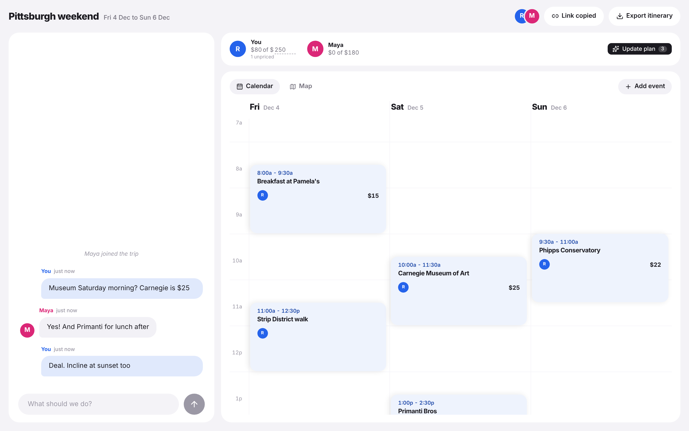

# Trip Planner

Group trips get planned in group chats, and then someone has to dig through 200 messages to figure out what was actually decided. This app keeps the chat and the plan in the same place: you talk it through with your friends, and the calendar, budgets and map update from what everyone agreed to.

<!-- Live demo: add the Vercel URL here once it's deployed -->

<p align="center">
  <a href="https://www.youtube.com/watch?v=rv8TqArMkfc">
    
  </a>
  <br>
  <sub>▶ <a href="https://www.youtube.com/watch?v=rv8TqArMkfc"><b>Watch the demo video</b></a></sub>
</p>



## What it does

- **Shared trip chat.** Start a trip, send an invite link, and everyone chats in real time. No accounts, you just open the link and pick a name.
- **Chat becomes a plan.** Hit **Update plan** and Gemini reads the new messages and proposes calendar changes. Nothing gets added for someone unless they said yes themselves, and anything the model gets wrong is rejected with a reason posted back in the chat.
- **Calendar you can edit by hand.** Click a slot to add an event, mark yourself going / not going, and see who's in.
- **Per-person budgets.** Each person sets a budget and only the events they're going to count against it.
- **Map and venues.** Places mentioned in chat get matched to real venues (Geoapify) with opening hours, and show up on a map of each day.
- **Export.** Download your own itinerary as an `.ics` file for Google/Apple Calendar.

## How it's built

React + Vite + Tailwind on the front end (FullCalendar, Leaflet), a Fastify API in TypeScript, and Postgres on Supabase (auth, realtime, row-level security). A separate worker process handles the slow stuff: it picks up chats that need planning, calls Gemini with a strict schema, validates every operation against the database, and enriches places.

A few things I'm happy with:

- Every edit carries the calendar version it was based on, so two people editing at once can't overwrite each other.
- Every write is idempotent, so retries never double-book anything.
- Times are stored as local date + minute in the trip's time zone, so DST weirdness doesn't move your dinner reservation.

The full design is in [docs/architecture.md](docs/architecture.md).

```
apps/web          React app
apps/server       Fastify API + the background worker
packages/db       Drizzle schema and SQL migrations
packages/contracts  shared Zod schemas
api/index.ts      Vercel function that serves the API
```

## Running it locally

You'll need Node 22+, a free [Supabase](https://supabase.com) project (with anonymous sign-ins turned on), and optionally a [Gemini API key](https://aistudio.google.com/apikey) and [Geoapify key](https://www.geoapify.com/) for the AI planning and venue lookup.

```bash
npm ci
cp .env.example .env      # fill in your Supabase URL/keys and database URLs
npm run db:migrate        # creates the tables

npm run dev:api           # API on :3000
npm run dev:worker        # background worker (AI planning + places)
npm run dev:web           # app on http://localhost:5173
```

Set `PROCESSING_MODE=demo` in `.env` and the worker plans after 3 messages or 20 seconds of quiet, which is nicer when showing it off.

Tests: `npm test` for unit tests, `./scripts/verify.sh` for everything (lint, types, unit + integration tests, build).

## Deploying (free)

The app and API deploy to **Vercel** (Hobby plan) straight from this repo; `vercel.json` is already set up. The database and auth live on **Supabase's** free tier. The worker is outbound-only, so it can run on any machine, including your laptop, and the app keeps working (chat, calendar, budgets, export) when it's off; only **Update plan** waits for it.

## License

MIT
